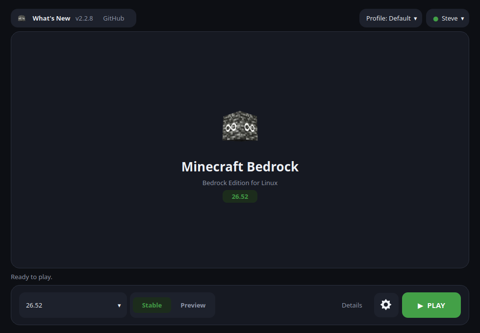

<div align="center">

# 🟩 BedrockOnLinux

**Minecraft Bedrock for Windows, running on Linux, with real Xbox sign-in,
Friends, servers and Realms.**

[](https://github.com/Wyze3306/BedrockOnLinux/releases/latest)
[](https://github.com/Wyze3306/BedrockOnLinux/releases)
[](https://wyze3306.github.io/BedrockOnLinux/)
[](https://discord.gg/5YJq54Yhbu)
[](LICENSE)




</div>

## What it is

BedrockOnLinux installs and runs the Windows version of Minecraft Bedrock on
Linux. It downloads the game from the Microsoft Store with your own account,
sets everything up, and starts it. No Windows, no second machine, nothing to
compile.

- **Online play as on Windows.** You sign in to Microsoft from inside
  Minecraft, so Friends, invitations, public servers, Realms and the
  Marketplace work. Nothing goes through a third party.
- **Stable and Preview**, any version: install an older build when a server
  hasn't updated yet.
- **Mouse, keyboard and controller**, in the game and in the launcher, which
  makes it usable on a Steam Deck.
- **Your content.** Import `.mcpack`, `.mcaddon`, `.mcworld` and
  `.mctemplate` files from **Settings ▸ Tools**; your worlds are backed up
  before a different version opens them.

Known limits: achievements show up in the game but don't unlock yet, and
starting the game needs an internet connection even for single-player, because
a Microsoft Store game stays encrypted on disk and Microsoft hands out its key
at each start.

## Install

Download the file for your system from the
[latest release](https://github.com/Wyze3306/BedrockOnLinux/releases/latest).

| Format | Best for | Install or start it |
|---|---|---|
| AppImage | Most Linux desktops, Steam Deck | `chmod +x BedrockOnLinux-*-x86_64.AppImage`, then run it |
| `.deb` | Debian, Ubuntu, Mint, LMDE | `sudo apt install ./bedrock-on-linux_*_amd64.deb` |
| `.rpm` | Fedora, Nobara | `sudo dnf install ./bedrock-on-linux-*.x86_64.rpm` |
| Flatpak | Atomic systems such as Bazzite | `flatpak install --user ./BedrockOnLinux-*-x86_64.flatpak` |
| Nix | NixOS, or any Linux with Nix | `nix run github:Wyze3306/BedrockOnLinux` |

The launcher tells you when a new version is out, if you let it check (see
[What it connects to](#what-it-connects-to)). The AppImage, the `.deb` and
the `.rpm` update themselves from **Update now**: the download is checked
against its SHA-256 and started once before it replaces anything, and an
AppImage that still fails to start is swapped back for the previous one. For
the Flatpak, download the new file and install it with the same command,
keeping `--user`; with Nix, update the flake input.

On NixOS, add `github:Wyze3306/BedrockOnLinux` as a flake input and install
`packages.x86_64-linux.default`.

## Play

1. Open **BedrockOnLinux** and sign in with the Microsoft account that owns
   Minecraft. You are asked twice, once for the Microsoft Store download and
   once for online play; use the same account both times.
2. Pick **Minecraft** or **Minecraft Preview**, choose a version, and hit
   **PLAY**.
3. Play, including the **Friends**, **Servers** and **Realms** tabs.

The first launch downloads the game and everything it needs, so give it a
while; after that it starts straight away.

Good to know:

- The first Store sign-in may bring up a password prompt from your desktop. It
  registers this PC as a Microsoft Store device, as Windows does. Cancelling
  it is fine.
- **Tools ▸ Create direct launch shortcut** adds a *Minecraft Bedrock* entry
  to your app menu or to Steam. That is the one to use on a Steam Deck.
- On a laptop with two graphics cards, **Settings ▸ Advanced ▸ Graphics card**
  chooses the one Minecraft plays on.
- The launcher works with a controller: d-pad or left stick to move, **A** to
  select, **B** to go back, **Start** to play.

## What you need

- A 64-bit (x86-64) Linux desktop, reasonably up to date.
- A graphics card and driver that support Vulkan: anything from the last few
  years, with the driver your distribution ships.
- A Microsoft account that owns Minecraft, since the game is downloaded under
  your own licence.
- A few gigabytes of free disk space for the game and its runtime.

### ARM computers (Apple silicon, Snapdragon, Raspberry Pi 5)

Minecraft for Windows only exists for x86-64, so on ARM the game and Wine run
through an x86-64 emulator. The launcher itself runs natively: start it from a
checkout with `git clone https://github.com/Wyze3306/BedrockOnLinux` and
`./BedrockOnLinux/bedrock-on-linux`.

- **Apple silicon with Fedora Asahi Remix:** install muvm and FEX-Emu
  (`sudo dnf install muvm fex-emu`). Asahi's kernel uses 16 KiB memory pages,
  which Wine cannot run on, so the launcher starts itself inside a muvm
  microVM with 4 KiB pages, the way Steam does there. Nothing else to set up.
- **Other ARM systems:** install [FEX-Emu](https://fex-emu.com) with its
  x86-64 RootFS, or Box64, registered with the kernel (binfmt_misc).

`bedrock-on-linux doctor` shows on its `cpu` line which emulator is used.

## What it connects to

The first time it starts, before it has contacted anything, the launcher shows
this list and asks how updates should be checked. Nothing connects by itself
until you have answered.

- **Automatic**: when the launcher starts, it looks for a launcher update and
  for a small signed data file of fixes (see below).
- **Only when I ask**: it looks when you press **Check now**, and not before.
- **Off**: it never looks, and keeps the versions it shipped with.

You can change this at any time in **Settings ▸ Network**, or with
`bedrock-on-linux network auto|ask|off`. `bedrock-on-linux network` prints the
list below.

**No telemetry, no usage statistics and no install or machine identifier is
ever sent, to anyone.** Requests to GitHub carry your IP address and the
launcher's name, like any download.

**Updates and data fixes (your choice below)**

| Hosts | Why | What is sent |
|---|---|---|
| `raw.githubusercontent.com` | The signed data file: component pins, per-version Minecraft fixes and incident notices. Checked against a key built into the launcher, so the server cannot alter it. | A plain download request: your IP address and the launcher's name as User-Agent. No account, no identifier. |
| `api.github.com` | The launcher's latest release, when the data file does not name one. | A plain download request: your IP address and the launcher's name as User-Agent. No account, no identifier. |
| `github.com`, `*.githubusercontent.com` | The launcher update itself, only after you click Update. Checked against its SHA-256 before it replaces anything. | A plain download request: your IP address and the launcher's name as User-Agent. No account, no identifier. |

**Installing or updating Minecraft and its runtime**

| Hosts | Why | What is sent |
|---|---|---|
| `api.github.com`, `github.com`, `*.githubusercontent.com`, `codeload.github.com` | The game engine, the Minecraft downloader, the online-login libraries, the sign-in web runtime, umu-launcher and GE-Proton, each checked against a pinned SHA-256. | A plain download request: your IP address and the launcher's name as User-Agent. No account, no identifier. |
| `raw.githubusercontent.com` | The index of Minecraft builds (MinecraftBedrockArchiver/GdkLinks) the version picker lists. | A plain download request: your IP address and the launcher's name as User-Agent. No account, no identifier. |
| `mirror.msys2.org`, `curl.se` | libcurl and the CA certificate bundle the game's network stack uses. | A plain download request: your IP address and the launcher's name as User-Agent. No account, no identifier. |
| `files.pythonhosted.org` | The Qt interface (PySide6), only where the system has none and the launcher installs its own copy. | A plain download request: your IP address and the launcher's name as User-Agent. No account, no identifier. |
| `repo.steampowered.com` | The Steam Linux Runtime container, downloaded by umu-launcher on first launch. | A plain download request: your IP address and the launcher's name as User-Agent. No account, no identifier. |
| `displaycatalog.mp.microsoft.com`, `fe3.delivery.mp.microsoft.com`, `*.xboxlive.com`, `*.dl.delivery.mp.microsoft.com`, `store-images.s-microsoft.com` | The Minecraft package itself, its licence and its Store artwork, from Microsoft's own servers. | Your Microsoft account's tokens, to Microsoft only: the Store checks that the account owns the game. |

**Signing in and playing online**

| Hosts | Why | What is sent |
|---|---|---|
| `login.live.com`, `account.microsoft.com`, `*.auth.xboxlive.com`, `sisu.xboxlive.com` | Signing in to your Microsoft account for the Store and Xbox Live. | Your Microsoft credentials, typed into Microsoft's own page, and the tokens it returns. |
| `userpresence.xboxlive.com`, `peoplehub.xboxlive.com`, `events.xboxlive.com`, `vortex.data.microsoft.com`, `*.playfabapi.com`, `multiplayer.minecraft.net`, `pocket.realms.minecraft.net` | Online play: presence, friends, achievements, Realms and multiplayer, on the game's behalf while it runs. | Your Xbox Live tokens and what the game itself would send: presence, achievements. |

**Browsing add-ons, mods and changelogs**

| Hosts | Why | What is sent |
|---|---|---|
| `api.mcpedl.com`, `mcpedl.com`, `www.curseforge.com`, `levimc.org`, `bedrock.graphics` | The add-on catalogue, LeviLamina mods and BetterRTX presets you browse or install. | A plain download request: your IP address and the launcher's name as User-Agent. No account, no identifier. Search words when you search. |
| `feedback.minecraft.net`, `api.github.com` | The Minecraft and launcher changelogs, when you open them. | A plain download request: your IP address and the launcher's name as User-Agent. No account, no identifier. |

**Reporting a problem (only when you press Send)**

| Hosts | Why | What is sent |
|---|---|---|
| `github.com` | The new-issue form of Wyze3306/BedrockOnLinux, filled in with your report, when no report relay is used. | Nothing by the launcher itself: your browser opens the form, and you submit it with your own GitHub account. |

The data file is how a fix reaches you without a new launcher release: new
anchors when a Minecraft build rearranges its menus, a rebuilt downloader, a
notice when Microsoft's sign-in is down. It is signed, and the launcher only
accepts it when the signature matches a key built into the launcher, so
neither the server it comes from nor anyone on the way can alter it. Every
download it points to is checked against a SHA-256 from that signed file.
[`docs/updates.md`](docs/updates.md) has the details.

## If something goes wrong

Start with the built-in check, which looks at your system and tells you what is
wrong:

```bash
bedrock-on-linux doctor
```

If the game misbehaves after an update or a crash, `bedrock-on-linux repair`
rebuilds the Windows environment without touching your worlds. Logs are one
click away in **Settings**.

Still stuck? Press **Report** at the foot of the menu (or **Settings ▸ Tools
▸ Report a problem**, or run `bedrock-on-linux report`). You write what goes
wrong; the launcher adds what a diagnosis needs: its version and how it was
installed, the engine and downloader revisions, your Minecraft build, your
distribution, kernel, desktop, GPU and driver, the settings that change
behaviour, and the end of the logs.

Everything goes through one privacy pass first. Your user name and home
folder, host name, gamertag and XUID, e-mail addresses, IP and MAC addresses,
serial numbers, every token and anything shaped like one, and the names of
your worlds, servers and profiles are removed or replaced, and a line that
might still name you is dropped whole. The window shows exactly what will be
sent, part by part, with a box to leave any part out, and names the host it
goes to. Nothing is sent before you press Send, and what you send becomes a
public issue. [`docs/report-relay.md`](docs/report-relay.md) has the details.

You can also ask on [Discord](https://discord.gg/5YJq54Yhbu) or
[open an issue](https://github.com/Wyze3306/BedrockOnLinux/issues) by hand,
but never with your account details.

## Uninstalling

Removing the app leaves what it downloaded: the game, your worlds, the game
engine and its runtime, several gigabytes in all. To remove everything:

1. To keep your worlds, first copy
   `~/.local/share/bedrock-on-linux/compatdata/pfx/drive_c/users/steamuser/AppData/Roaming/Minecraft Bedrock`
   somewhere else.
2. Delete `~/.local/share/bedrock-on-linux` (or the folder you moved the
   installation to in **Settings**) and `~/.config/bedrock-on-linux`.
3. Delete the shortcuts the launcher made, if any:
   `~/.local/share/applications/bedrock-on-linux-*.desktop` and the
   *Minecraft Bedrock* entry in Steam.

For the Flatpak, `flatpak uninstall --delete-data io.github.wyze3306.BedrockOnLinux`
does all of it.

## Building

Everything is built from source by a public, reproducible pipeline, and each
release is signed. The details are in [`docs/BUILD.md`](docs/BUILD.md).

## Legal

BedrockOnLinux ships **no Minecraft game files**. The game is downloaded from
Microsoft's own servers, under your own account's licence, by
[Xodus](https://github.com/xodus-gaming/xodus), so you have to own Minecraft,
and the terms that come with it still apply.

BedrockOnLinux is MIT licensed, see [`LICENSE`](LICENSE); the components it
bundles keep their own licences. This is an independent project, not affiliated
with or supported by Mojang or Microsoft.
